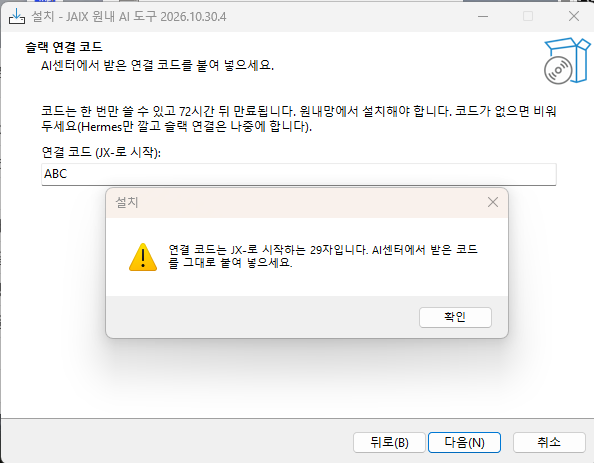

# namun-ji 실기 측정 (jaix-win, 2026-10-27〜11-03)

연구원 PC와 같은 Windows에서 세 채널(데스크톱 앱 · CLI · Hermes 슬랙)이 jaix-kit 도구를 실제로 실행하는지 잰 기록이다.
인계: [handoff/jaix-win.md](handoff/jaix-win.md). 이 세션은 측정과 기록만 했고, 도구 코드는 고치지 않았다(버그는 이슈로).

## 환경

| 항목 | 값 |
|---|---|
| PC | namun-ji · Windows 11 Home 26300 · i5-10400 · 16GB · 원내망(유선, 출구 IP는 gw `/ip` 허용 목록 안) |
| 시험 계정 | `jaix-test` 표준 사용자(관리자 아님). 업무 계정 `user` 의 Claude·Codex·Hermes 설정은 건드리지 않음 |
| 조작 | 사용자가 화면에서 직접(Synergy 키보드·마우스 공유), 측정 세션은 맥에서 `ssh namun-ji`(관리자 셸)로 파일·프로세스·이벤트를 읽음 |
| 미리 깔린 것 | 한컴오피스 2022 · hwp2pdf-cli 2026.09.28.1(관리자 설치, `C:\Program Files`) · Git 2.54.0(시스템) · Node(다른 계정이 시스템 범위로 설치) · AhnLab |
| AI 계정 | 사용자 개인 계정으로 시험. 11/1 기관 계정 전환 뒤 **조직 기능(관리자 콘솔·조직 플러그인)은 다시 재야 함** |
| Defender | 서명 1.461.233.0(10/28) → 1.463.16.0(10/29) → 1.463.31.0(10/30) |

시험한 설치본: v2026.10.27.2 · .6 · .8 · .13, v2026.10.28.1 · .2 · .5 · .7, v2026.10.30.2 · .4 · .8.
스크린샷은 대부분 세션 임시 폴더에 있다가 지워져 이 문서에는 한 장만 남았다(아래 Q9).

## 요약

| # | 질문 | 판정 | 한 줄 |
|---|---|---|---|
| 1 | Cowork on Windows Home | ✅ / ❌(설치 권한) | 실행은 됨. 데스크톱 앱 설치 자체가 관리자 자격 증명을 요구 |
| 2 | Cowork 플러그인 스킬 | ⚠️ | 계정 단위 플러그인이라 `settings.json` 으로는 안 옴 → 관리자 콘솔 경로(#19 ①) |
| 3 | Cowork stdio MCP | ⚠️ | **Windows 호스트에서** 뜸(격리 VM 아님). MSIX 가상화로 uv Python이 깨지는 함정 → 앱 밖 `uv python install` 로 해결(#14) |
| 4 | Code 탭 | ✅ | 2단계(첫 실행 마켓 복제 → 다음 실행 설치) 뒤 hwp-agent·korea-rio MCP 7+7 |
| 5 | Claude Code CLI | ✅ | 플러그인 6 · 스킬 7 · MCP 7+7. Bash 도구는 Git Bash. jaix 플러그인엔 훅 없음 |
| 6 | Codex | ✅(jaix 설정 후) | `${CLAUDE_PLUGIN_ROOT}` 미치환 → jaix가 `[mcp_servers]` 절대경로를 써서 해결(#23·#36) |
| 7 | autoUpdate | ⚠️ | Code 탭·CLI는 jaix setup/update 로 잠금에 맞춰짐. "재시작만으로 전파"(0-4)는 따로 재지 못함. Desktop은 GitHub App 권한 필요 |
| 8 | 한글·공백 경로 convert | ✅ | `바탕 화면\2026 과제\서식.hwp` → hwpx, 포터블 JRE로 성공 |
| 9 | Hermes | ✅(jaix 무인 설치) | 수동 13화면·질문 대기 → jaix-setup 무인 9분, 질문 0. 슬랙 연결 코드로 봇 연결까지 |

## 질문별 상세

### Q1. Cowork(Claude Desktop) on Windows 11 Home
- Claude Desktop은 MSIX(`Claude_pzs8sxrjxfjjc`)이고 **설치 때 관리자 자격 증명을 물었다**(전체 사용자 프로비저닝 + `CoworkVMService` 서비스). 표준 사용자 혼자서는 못 깐다 → 연구원 PC는 IT가 미리 깔아야 함.
  - 부작용: 관리자 자격 증명을 넣자 같은 PC `user` 계정의 Claude도 2.16120 → 3.6556.2로 올라갔다(측정 세션이 미리 경고하지 못함).
- VirtualMachinePlatform이 이미 켜져 있어 Cowork는 바로 떴다. Windows Home이라서 막히지는 않음.
- Cowork 세션은 **클라우드**에서 돈다(Firecracker 커널). PC는 "연결된 컴퓨터"로 붙고, `device_bash` 는 로컬 Hyper-V 리눅스 VM에서 **승인한 폴더만** 보인다(`/sessions/<id>/mnt/...`).

### Q2. Cowork에서 플러그인 스킬
- Desktop·Cowork는 `~/.claude/settings.json` 의 `extraKnownMarketplaces` 를 **읽지 않는다**(로그 `NativeMarketplaceReader Found 0`). 플러그인은 계정 단위 백엔드 마켓(`RemotePluginManager`)에서 온다.
- Desktop UI로 마켓을 추가하면 스킬이 보였다. 자동 동기화 안내는 Claude GitHub App 저장소 접근을 요구했고, 사용자가 허용하지 않았다.
- 결론: **Desktop·Cowork는 관리자 콘솔(조직 플러그인) 경로**로 간다(#19 ①, 11/1-9 실측 예정). 11/3 현재 콘솔 설정이 진행 중이라 조직 플러그인 실측은 아직이다.

### Q3. Cowork에서 stdio MCP — 설계 최대 리스크
- 플러그인 stdio MCP는 **클라우드도 VM도 아닌 Windows 호스트에서** 뜬다(`LocalMcpServerManager` → `localMcpBridge` 중계). 로컬 파일 접근은 MCP 쪽에서는 호스트 그대로다.
- 함정(#14): MSIX 파일 가상화 때문에 앱 안에서 uv가 Python을 처음 받으면 `%APPDATA%\uv\python` 이 `LocalCache\Roaming\…` 로 옮겨 써지고, uv 정션이 실제 경로를 가리켜 깨진다 → **MCP가 오류 없이 안 뜬다.** 앱 밖에서 `uv python install 3.12` 를 해 두면 해결(이후 jaix setup이 함).
- 또 uvx가 Python 3.15를 고르면 lxml 휠이 없어 빌드 실패 → 플러그인 `.mcp.json` 의 `--python 3.12` 고정(hwp-agent#75)으로 해결.

### Q4. Desktop Code 탭
- Code 탭(내장 Claude Code 2.1.308, `%LOCALAPPDATA%\Claude-Data\claude_*\claude-code\<버전>\…\claude.exe`)은 `settings.json` 을 **두 단계로** 읽는다: 첫 실행에 마켓 복제, 그다음 실행에 `enabledPlugins` 설치. (#19 ② 처음 보고는 "설치 안 함"이었다가 정정.)
- v2026.10.28.1 뒤: Desktop 완전 종료(알림 영역 ^ → Claude 우클릭 → Exit) 후 다시 열면 hwp-agent 7 + korea-rio 7 도구. 프로세스는 `uvx --from …\.claude\plugins\cache\jaix\…` · Roaming uv Python 3.12.
- Code 탭 `/mcp` 는 MCP 목록이 아니라 계정 커넥터 설정을 연다 → 도구 노출은 에이전트에게 묻거나 프로세스로 확인했다.
- 창 X·작업 표시줄 닫기로는 앱이 꺼지지 않는다(안내문 반영됨).

### Q5. Claude Code CLI
- `irm https://claude.ai/install.ps1 | iex` → `~\.local\bin\claude.exe`.
- `/plugin`: jaix 플러그인 6 · 스킬 7(목록 약 660 토큰). `/mcp`: hwp-agent 7 · korea-rio 7.
- Bash 도구 셸은 **Git Bash**(`MINGW64_NT-10.0-26300`). jaix 플러그인에는 `hooks.json` 이 없어 훅 셸 질문은 해당 없음.

### Q6. Codex
- Codex CLI 0.164.0(npm `-g`, `%APPDATA%\npm\codex.CMD`). 이 PC는 Node가 다른 계정 시스템 범위라 `%APPDATA%\npm` 이 사용자 PATH에 없었다 → jaix가 찾도록 고침.
- 같은 마켓(`jeju-inst/jaix-kit`)을 읽고 플러그인을 깐다. 하지만 **`${CLAUDE_PLUGIN_ROOT}` 를 치환하지 않아** MCP가 실패했다(#23).
- 첫 실행 샌드박스 선택: 기본값은 관리자 필요, 비관리자를 고르면 `[windows] sandbox = "unelevated"`.
- jaix가 `config.toml` 에 `[mcp_servers.*]` 절대경로를 쓰게 된 뒤(v2026.10.28.1, cmd 메타문자 버그 #36 수정 포함) `/mcp`: hwp-agent 7 · korea-rio 7.
- 관찰: Codex가 `C:\Windows\System32` 에서 시작했다(작업 폴더 안내 필요할 수 있음).

### Q7. autoUpdate(인수 0-4)
- Claude Code·Code 탭: 마켓 `autoUpdate: true` 로 등록되고, jaix 로그온 갱신 작업(`jaix-update`, 로그온 +2분, `jaixw.exe update --quiet`)이 Codex·Hermes까지 잠금에 맞춘다. doctor 기준 플러그인 버전은 매번 잠금과 같았다.
- "잠금 bump → 앱 재시작만으로 새 버전"을 따로 떼어 재지는 못했다(위 갱신 작업이 같이 돌아 구분이 안 됨).
- Desktop(Cowork)은 GitHub App 권한 없이는 자동 동기화가 안 됨 → 관리자 콘솔 경로.

### Q8. 한글·공백 경로(인수 0-6)
- `C:\Users\jaix-test\Desktop\2026 과제\서식.hwp` → `서식.hwpx`(21,526바이트). Code 탭 에이전트가 CLI로 변환했고 jaix 포터블 JRE로 성공.
- 렌더도 같은 폴더에서 `hwp-agent pdf "서식.hwpx"` 성공(아래 렌더 절).

### Q9. Hermes
**수동 설치(10/28, 비교 기준)** — `iex (irm https://hermes-agent.nousresearch.com/install.ps1)`
- 7분쯤에 `hermes.exe` 가 생기고 3,055MB에서 Y/n 질문 둘(게이트웨이 지금 시작 / 자동 시작) 앞에 멈췄다. 사람이 자리를 비워 약 2시간 40분 대기.
- Y 뒤 setup 마법사 **13화면**. Nous Portal이 기본값인 화면이 셋(모델·이미지·검색) → 엔터만 치면 Nous로 간다.
- "Coming from another agent?" 는 Codex MCP(hwp-agent·korea-rio)만 가져오고 스킬·AGENTS.md·메모리는 건너뜀. `import-agent` 에 항목 선택 옵션 없음.
- 게이트웨이 서비스 Yes → UAC 요청 → No → 시작프로그램 `Hermes_Gateway.vbs` 로 대체(관리자 없이 됨).
- Tools 화면은 Computer Use·Browser·Terminal이 기본 켜짐.
- hwp-agent MCP가 Hermes 자체 Python 3.14로 떠서 lxml 빌드 실패(#45). `--python 3.12` 를 넣고 재부팅하니 11개 도구 연결.

**jaix-setup 무인 설치(10/30, v2026.10.30.4 → .8)** — 체크리스트는 jaix-setup이 보낸 1-12

| # | 항목 | 판정 | 근거 |
|---|---|---|---|
| 1 | 설치기 화면 | ✅ | "슬랙으로도 쓰기" 체크 → "슬랙 연결 코드"·"Hermes가 쓸 AI" 화면. `abc` 는 오류 창, 빈칸은 통과 |
| 2 | 비대화형 설치 | ✅ | UAC·Y/n 없음(사용자가 화면 확인). setup 19:02:27-19:12:55, Hermes 단계 약 9분, `%LOCALAPPDATA%\hermes` 2,580MB, Defender 1116/1117 0건 |
| 3 | 코드 흔적 | ✅ | `pending\` 비어 있음. setup.log·hermes.json·Inno 로그에서 `xoxb-`·`xapp-` 0건, `JX-` 는 설치기 오류 문구뿐 |
| 4 | 시작프로그램 gateway | ⚠️ | `Startup\Hermes_Gateway.vbs` 생성, Hermes 예약 작업 없음(UAC 경로 안 탐). **재로그온 뒤 기동은 아직 미확인** |
| 5 | .env | ✅ | `SLACK_BOT_TOKEN`·`SLACK_APP_TOKEN`·`SLACK_ALLOWED_USERS` 키 존재(값은 보지 않음), `.env.bak-*` 생성 |
| 6 | gateway.log | ✅ | `slack-namespace: /hermes-jitest -> /hermes handler registered`, `✓ slack connected` |
| 7 | toolset | ✅ | cli·slack 모두 browser·computer_use 빠짐(`hermes tools list --platform slack` ✗). `model.provider: openai-codex`. `config.yaml.jaix-bak-*` |
| 8 | MCP·스킬 | ✅ | `mcp_servers` 에 hwp-agent·korea-rio(args 맨 앞 `--python 3.12`), `skills\jaix\` 6개 |
| 9 | 로그인 창 | ✅ | [마침] → `cmd /K hermes auth add openai-codex` → 기기 코드 승인 → "Added openai-codex OAuth credential #1" |
| 10 | 슬랙 | ✅ | DM에 답함, `/hermes-jitest help` 동작 |
| 11 | doctor | ✅ | 코드 없음일 때 [주의] "슬랙 연결 안 됨(연결 코드 없음)", 연결 뒤 [통과] "Hermes-jitest 연결 기록" |
| 12 | 실패 경로 | 미시험 | v2026.10.30.8에는 다시 설치 때 기록을 덮는 버그가 있어(#72로 수정) v2026.10.30.11로 할 예정 |

- 2차(코드 넣기)는 Hermes가 이미 있어 약 3분(19:29:32-19:32:25). "Hermes: 이미 있음" → 설정 재적용 → "슬랙: Hermes-jitest 연결됨".
- 관리자 쪽에서 막힌 것: `jaix hermes handoff` 가 `args.log` 로 바로 죽음(#67), 슬랙 봇 핸들이 하이픈 없는 `hermesjitest` 라 이름 검사에서 멈춤(#69, hermes-slackbot#17). 둘 다 PR로 고쳐짐. 실측은 함수 직접 호출 우회로 진행했다.
- 시험용 앱 `Hermes-jitest` 는 테스트 계정의 설정 토큰으로 만들어 **앱 소유자가 테스트 계정**이고, 그 계정은 앱 설치 권한이 없어 관리자 승인을 거쳤다. 실제 배포 때는 관리자 계정으로 `provision_app.py token set` 을 다시 해야 `update-all` 대상에 들어간다.
- 슬랙에서 본 것(연구원에게는 소음):
  - 첫 DM에 영어 시스템 안내 2개(홈 채널 `/hermes sethome`, Codex 컨텍스트 자동 요약 85%).
  - `help` 목록이 `/new` 처럼 접두어 없이 나와, 실제로 쳐야 하는 `/hermes-jitest new` 와 다르다.
  - `/login`·`/topup`(Nous), `/yolo` 가 그대로 보인다. 스킬 57개 중 jaix 것은 6개.

## jaix-setup.exe 체크리스트(#11)

| # | 항목 | 판정 | 근거 |
|---|---|---|---|
| 1 | UAC·SmartScreen | ✅ | 모든 판에서 UAC 없음. **SmartScreen 창은 한 번도 안 뜸**(Edge의 "일반적으로 다운로드되지 않습니다" 경고만, 받은 파일은 MOTW ZoneId=3) |
| 2 | 체크리스트·진행 | ✅ | Claude 기본 체크, Codex는 있으면 체크. v.2 기준 약 1분 |
| 3 | 마지막 안내·재부팅 | ✅ | 재부팅 없음. 안내문 문구는 #19 등으로 여러 번 고쳐짐 |
| 4 | doctor(0-3) | ✅ | v2026.10.30.2 기준 "결과: 정상". 회사망 막힌 주소 없음(0-7) |
| 5 | 런타임 출처 | ✅ | uv·JRE는 포터블(`Programs\jaix\bin`·`jre`), Git은 시스템에 있던 것 사용 |
| 6 | Desktop 재시작 → 플러그인(0-2) | ⚠️ | Code 탭 ✅(2단계), Cowork ❌(settings.json 안 읽음 → 관리자 콘솔) |
| 7 | Codex 플러그인 | ✅ | jaix 6개 + MCP 2개 |
| 8 | 한글 경로 convert(0-6) | ✅ | Q8 |
| 9 | 제거 | 미시험 | 시험이 끝난 뒤 마지막에 할 예정 |

### 판별로 따라온 것
- **Defender 오탐(#46)**: v2026.10.28.5 실행 뒤 10-25초 사이 `Trojan:Win32/Bearfoos.B!ml`(ML·클라우드 판정)로 설치 파일을 격리. 설치는 이미 끝나 있었고 깔린 `jaix.exe` 는 무사했다. 같은 파일(sha 동일)을 10/30 서명 1.463.31.0으로 다시 받아 정적 검사하니 무탐지. 이후 onedir 판(.7 이후)은 받기·실행 모두 무탐지. 코드 서명 없이 가기로 했고 오탐 제출은 사용자가 한다.
- **덮어 설치 직후 Codex '옛 버전' 오탐(#48)**: 이미 켜진 플러그인을 건너뛰면서 설치 기록이 낡아 생김. #52로 고침(이 PC는 기록이 이미 맞춰져 있어 재현 생략).
- **onedir 전환(.7)**: 예전 `{app}\jaix.exe` 삭제, 사용자 PATH에서 `{app}` 빠지고 `{app}\jaix` 만, 예약 작업 `…\jaix\jaixw.exe`.
- **로그온 갱신 창**: v.8은 콘솔 창이 보였고 실패(코드 1, 해시 비교 버그). v2026.10.28.1부터 `jaixw.exe` 로 창 없이 성공(3분 지켜봄).
- **설치기 안에서 uv os error 448**(RedirectionGuard): 설치기 프로세스에서만 정션 검증 실패. 작업 스케줄러 경유(`--via-task`)로 해결.
- **doctor 중복 점검(#51)**: 단독 hwp-agent 설치본·같은 이름 마켓 플러그인·`~/.claude/skills` 같은 이름 폴더를 한 줄 [주의]로 잡음. 단독 설치본이 Codex `[mcp_servers.hwp-agent]` 를 덮어쓰면 중복이 아니라 [실패]로 나오고 문구가 원인과 다름. 단독 설치본 제거기는 Claude가 MCP로 잡고 있으면 `hwp-agent.exe`·PATH 항목을 남김.

## 렌더(hwp-agent)
- 한글이 꺼져 있으면 `via hwp2pdf-cli · 한컴 · 이 PC`, 한글 출력 깨짐 없음.
- 한글이 켜져 있으면(어느 계정이든, PC 전체 기준) hwp2pdf-cli를 건너뛰고 rhwp로 대체: `via rhwp · 근사 레이아웃` + 근사 안내. rhwp는 jaix setup이 미리 받는다(v0.8.7). 출력 앞에 cp949 `UnicodeDecodeError` traceback이 찍힘(hwp-agent#83, PDF는 정상).
- **한컴 첫 실행 동의창**: `%APPDATA%\Hnc\User\Common\120\optionInfo.xml` 이 없으면 "사용성 데이터 수집 동의" 창이 렌더를 막고, 약 2분 뒤 hwp2pdf-cli가 "한글을 시작하지 못했습니다"로 실패해 rhwp로 넘어간다(동의창 안내 없음). `EnableUsabilityLog=0`·`EnableUsabilityLogSending=0` 만 든 최소 파일을 미리 두면 창 없이 8초. → jaix setup(#63)·hwp2pdf#7에 반영됨.

## gw(그룹웨어)
- 원내망에서 `/ip` 허용, setup이 gw를 깔고 doctor [통과](#51 이후 uv-receipt 경로 비교).
- 콘솔 `gw login` → 자격 증명 관리자 2항목, `gw logout` → 0.
- 에이전트 경로: tkinter 로그인 창이 앞에 뜸. 취소하면 gw .28.1부터 재시도하지 않고 다시 띄울지 묻는다.
- 로그인 없이 결재를 조회하면 오류가 아니라 0건으로 돌아온다 → 에이전트가 바로잡지 않으면 "결재 없음"으로 오해할 수 있음(jaix-standard 후속).

## 그 밖에 적어 둘 것
- jaix-test 사용자 PATH에 다른 계정 경로 `C:\Users\user\AppData\Local\Microsoft\WindowsApps` 가 있다. jaix 기록·코드에는 넣은 흔적이 없고, Hermes 재설치 때 새로 생기지도 않았다. 출처 미확인.
- 설치 완료 화면에 버전이 안 나온다(setup.log 머리에만). 문의 대응을 위해 화면에도 버전을 적자는 사용자 제안.
- ssh(세션 0)에서 도는 명령은 한컴 COM이 안 뜬다. 렌더·doctor 재현은 대상 사용자의 대화형 예약 작업으로 돌렸다.

## jaix-setup이 해야 할 일(측정에서 나온 것)
대부분 시험 기간 중 이미 PR로 들어갔다. 남은 것만:
- [ ] Desktop·Cowork 플러그인은 관리자 콘솔로만 온다 — 11/1 이후 조직 플러그인 실측(콘솔 설정 진행 중).
- [ ] 단독 hwp-agent 설치본과의 충돌: 설치기가 jaix를 감지하면 MCP 자동 등록 체크 해제, doctor 문구 "다른 설치본이 차지"(jaix-setup·jaix-standard에 배정됨).
- [ ] Hermes 슬랙 소음 정리(영어 첫 안내, 접두어 없는 help, Nous 명령, 기본 스킬 51개) — hermes-slackbot 판단.
- [ ] 설치 완료 화면에 버전 표시.
- [ ] Hermes 남은 실측: 재로그온 기동(4), 같은 코드 재사용·코드 없이 재설치(12), 제거(#11-9).

## 인수 시험 0절 반영
[acceptance-tests.md](acceptance-tests.md) 0절에 namun-ji 결과 줄을 붙였다.

## 이슈
jeju-inst/jaix-kit #14 #19 #23 #36 #45 #46 #48 #67 #69 · z0nam/hwp-agent #75 #83
